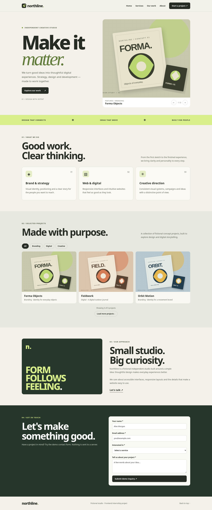

# Northline Studio — Responsive Frontend

Responsive studio website with HTML, CSS, JavaScript and interactive React components.

[Mobile preview](docs/mobile-preview.png)

## Features

- Responsive landing page with Home, Services, Our work, About and Contact sections.
- Sticky responsive navigation with mobile toggle, Escape-to-close and link selection.
- CSS hover transitions, entry animations and reduced-motion support.
- React `Slider`: three featured projects, previous/next controls, keyboard arrows and wraparound.
- React `Gallery`: category filtering and dynamic Load More content from a local data array.
- React `ContactForm`: controlled inputs, required field validation, email validation, minimum message length and local confirmation.
- Original local SVG project illustrations; no external image calls.
- Fictional studio and concept projects. Contact form does not send email or data to a server.

## Implementation

HTML and CSS structure the site. Vanilla JS handles the mobile menu. Three actual React class components manage interactive UI using `React.createElement`, state and `ReactDOM.render`. Local UMD builds of React 16.0.0 and ReactDOM 16.0.1 (MIT; see `vendor/LICENSE.txt`) are bundled for a zero-install educational demo. These older builds are not recommended for new production applications. No JSX compiler, npm installation or CDN connection is required.

## Run locally

Extract the ZIP, open this project folder in VS Code, and use **Open with Live Server** on `index.html`. Alternatively, with Python installed, run `python -m http.server 8000` from this folder and open `http://localhost:8000`. The project can also be opened as a static HTML page, but browser storage on `file://` URLs varies; localhost or HTTPS is recommended. No backend is required.

## GitHub upload

See [UPLOAD-GUIDE.md](UPLOAD-GUIDE.md) for the complete GitHub Desktop procedure. Use a separate public repository named `studio-frontend` if the evaluator requires public access. A public GitHub repository is sufficient if the assignment asks only for source code; enable GitHub Pages only if a live demo is required or desired.

## Files

- `index.html` — semantic markup
- `style.css` — responsive layout, design and animations
- `script.js` — application functionality
- `docs/` — screenshots from browser tests
- `tests/browser_test.py` — optional automated tests
- `UPLOAD-GUIDE.md` — submission instructions
 - `vendor/` — local React and ReactDOM builds with license
- `assets/` — original SVG artwork

## Testing

JavaScript syntax and Chromium functional integration tests passed, including horizontal-overflow checks at 320, 390, 768, 1024 and 1440 pixels. In the restricted authoring environment direct URL navigation was blocked. The tests therefore loaded the actual markup, styles and scripts into Chromium with an in-memory storage adapter for refresh tests; the studio test also resolves local SVGs as embedded data URLs. Native localStorage behavior under a real URL and GitHub Pages deployment were not independently verified. The application itself uses standard browser APIs and relative local assets.

Optional: install Python Playwright (`pip install playwright`), then `playwright install chromium` and run `python tests/browser_test.py` from the project folder. Tests use a temporary localhost server by default. Set environment variable `OFFLINE_TEST=1` to run the restricted-environment harness instead. Set `CHROMIUM_PATH` to use an existing Chromium executable. The tests regenerate preview screenshots.
